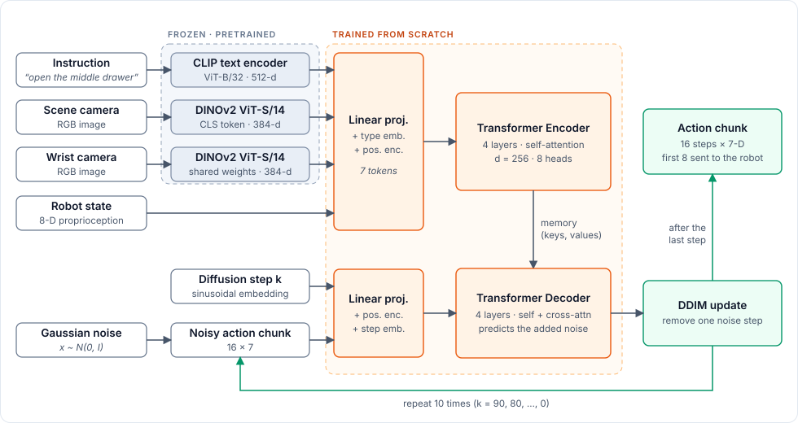

# From Instruction to Action

Language-conditioned robot manipulation with a Transformer diffusion policy trained from scratch.

CS495 Deep Learning · Mediterranean Institute of Technology (MedTech)

<p align="center">
  
</p>

A simulated Franka Panda arm receives a natural-language command such as *"open the middle drawer of the cabinet"*, observes the scene through a fixed camera and a wrist camera, and produces the next 16 end-effector actions by iteratively denoising a sample of Gaussian noise. Training and evaluation use the [LIBERO](https://libero-project.github.io/) benchmark.

The pretrained vision and language encoders are kept frozen. Everything that maps their features to actions, including attention, the encoder–decoder stack and the diffusion sampler, is implemented from first principles in PyTorch without `nn.Transformer`, `nn.MultiheadAttention` or `diffusers`.

## Method

**Observation encoding.** At each control step the policy receives the last two frames from both cameras, the robot state, and the instruction. Images are embedded with a frozen DINOv2 ViT-S/14 (384-d CLS token) and the instruction with a frozen CLIP ViT-B/32 text encoder (512-d). Each input type is linearly projected to `d_model = 256`, tagged with a learned type embedding and a positional encoding, giving 7 tokens (1 language + 2 × scene + 2 × wrist + 2 × state). A 4-layer Transformer encoder fuses them into a memory sequence.

**Action denoising.** The action chunk is a 16 × 7 matrix (position delta, rotation delta, gripper). During training, a diffusion step *k* is sampled, noise is added to the ground-truth chunk using a cosine DDPM schedule with *K* = 100 steps, and a 4-layer Transformer decoder predicts that noise from the noisy chunk, the step embedding and cross-attention to the memory. The loss is the mean squared error on the noise.

**Inference.** The observation is encoded once. Starting from pure noise, the decoder is called 10 times with a deterministic DDIM sampler. The robot executes the first 8 actions of the resulting chunk before the policy is queried again.

| Component | Source | Trained | Output |
|---|---|---|---|
| Image encoder | DINOv2 ViT-S/14, `facebook/dinov2-small` | frozen | 384-d per camera frame |
| Text encoder | CLIP ViT-B/32, `openai/clip-vit-base-patch32` | frozen | 512-d per instruction |
| Encoder–decoder Transformer | this repository | from scratch (~10M params) | predicted noise, 16 × 7 |
| Noise scheduler (DDPM / DDIM) | this repository | no parameters | denoised action chunk |

Because the encoders are frozen, their features are computed once over the dataset and cached to disk. This keeps training within a 6 GB GPU. Image augmentations (random crop, colour jitter) are applied before caching, with several augmented views stored per frame.

## Experiments

All results are reported as success rate over the 50 fixed initial states per task.

| Experiment | Question |
|---|---|
| LIBERO-Goal, 10 tasks | Can the policy follow different instructions in the same scene? |
| Regression baseline | Does diffusion help compared to predicting the chunk directly with an L1 loss (ACT-style)? |
| Ablations | Effect of the number of DDIM steps and the observation history length |
| Instruction swap | Given the same initial scene, does changing the command change the behaviour? |
| Paraphrases | Does the policy generalise to rewordings not seen during training? |
| All 40 tasks | How does performance scale to the full LIBERO suite? |

Results will be added here as runs complete.

| Model | LIBERO-Goal SR | Paraphrase SR | Inference (ms / chunk) |
|---|---|---|---|
| Regression baseline | – | – | – |
| Diffusion policy (ours) | – | – | – |

## Repository layout

```
configs/default.yaml       hyperparameters for data, model, diffusion, training and evaluation
ita/
  data/                    embedding cache, normalisation, (observation, action chunk) dataset
  models/                  Transformer layers and the full diffusion policy
  diffusion/               DDPM noise schedule and DDIM sampler
  eval/                    closed-loop rollouts in LIBERO, language-grounding tests
  utils.py                 config loading, seeding, LeRobot helpers
scripts/                   environment check, dataset inspection, simulator sanity checks
tests/                     unit tests for the Transformer and the scheduler
demo/app.py                Gradio demo
docs/figures/              figures used in this README
```

## Installation

LIBERO depends on robosuite and MuJoCo, which are supported on Linux. On Windows, use WSL2 with Ubuntu 22.04; CUDA works inside WSL2 with a recent NVIDIA driver.

```bash
sudo apt update
sudo apt install -y build-essential git cmake ffmpeg libegl1 libgl1 libosmesa6-dev

conda create -n ita python=3.12 -y   # current LeRobot requires Python >= 3.12
conda activate ita

# Clone into the Linux filesystem (~/), not /mnt/c: file access across the boundary is slow.
cd ~
git clone https://github.com/huggingface/lerobot.git
pip install -e "lerobot[libero]"

git clone https://github.com/Ahmed-Hammoda/ita-diffusion-policy.git
cd ita-diffusion-policy
pip install -r requirements.txt
pip install -e .

echo 'export MUJOCO_GL=egl' >> ~/.bashrc   # use osmesa if EGL is unavailable
source ~/.bashrc
```

The name of the LeRobot extra has changed between releases. If the install above fails, check the [LeRobot LIBERO documentation](https://huggingface.co/docs/lerobot/libero). On first import, LIBERO asks whether to set a custom dataset path; answer `N`.

Verify the setup:

```bash
python scripts/00_check_env.py
```

## Getting started

```bash
# Inspect the dataset: features, shapes, instructions and statistics.
python scripts/01_explore_dataset.py --episodes 0 1 2

# Run the simulator with random actions and save a video to outputs/sim/.
python scripts/02_sim_rollout.py --suite libero_goal --task-id 0

# Compare dataset and simulator images, then set eval.flip_sim_images in the config.
python scripts/03_check_orientation.py

# Unit tests for the from-scratch modules.
pytest
```

## Implementation notes

- **Image orientation.** Raw LIBERO renders are rotated 180° relative to some versions of the dataset. A mismatch here silently drives the success rate to zero, so `scripts/03_check_orientation.py` should be run before any evaluation.
- **State and action conventions.** At evaluation time the 8-D state must be built from the simulator exactly as in the dataset (end-effector position, axis-angle rotation, gripper joint positions), and normalised with the statistics saved during training.
- **Episode-level split.** Validation episodes are held out as whole episodes; frames from one episode never appear in both splits.
- **Language generalisation.** LIBERO has only 40 distinct instructions, so a policy can memorise their embeddings. Paraphrases used for testing are kept separate from any used for training.

## Roadmap

The project runs over four weeks. Work in each week is split across the four areas listed under [Team](#team) and proceeds in parallel.

**Week 1 · Foundations**
- [ ] Environment set up on every machine, simulator video recorded, image orientation checked
- [ ] Dataset downloaded, embedding cache and data pipeline written
- [ ] Transformer layers and noise scheduler implemented and passing unit tests

**Week 2 · First policy**
- [ ] Full model overfits a small subset end to end
- [ ] Training on LIBERO-Goal, first success rates in simulation
- [ ] Regression baseline trained on the same data

**Week 3 · Experiments**
- [ ] Ablations on DDIM steps and observation history length
- [ ] Instruction-swap and paraphrase experiments
- [ ] Scale to all 40 tasks if time allows

**Week 4 · Delivery**
- [ ] Gradio demo
- [ ] Final results, plots and report
- [ ] Demo video

## Team

| Area | Scope |
|---|---|
| Data | Dataset loading, normalisation, episode split, embedding cache |
| Model | Transformer implementation and unit tests |
| Diffusion & training | Noise scheduler, training loop, regression baseline |
| Simulation & evaluation | LIBERO rollouts, language-grounding tests, demo |

## References

1. B. Liu et al. *LIBERO: Benchmarking Knowledge Transfer for Lifelong Robot Learning.* NeurIPS 2023. [arXiv:2306.03310](https://arxiv.org/abs/2306.03310)
2. C. Chi et al. *Diffusion Policy: Visuomotor Policy Learning via Action Diffusion.* RSS 2023. [arXiv:2303.04137](https://arxiv.org/abs/2303.04137)
3. T. Z. Zhao et al. *Learning Fine-Grained Bimanual Manipulation with Low-Cost Hardware* (ACT). RSS 2023. [arXiv:2304.13705](https://arxiv.org/abs/2304.13705)
4. M. Shukor et al. *SmolVLA: A Vision-Language-Action Model for Affordable and Efficient Robotics.* 2025. [arXiv:2506.01844](https://arxiv.org/abs/2506.01844)
5. A. Vaswani et al. *Attention Is All You Need.* NeurIPS 2017. [arXiv:1706.03762](https://arxiv.org/abs/1706.03762)
6. J. Ho, A. Jain, P. Abbeel. *Denoising Diffusion Probabilistic Models.* NeurIPS 2020. [arXiv:2006.11239](https://arxiv.org/abs/2006.11239)
7. J. Song, C. Meng, S. Ermon. *Denoising Diffusion Implicit Models.* ICLR 2021. [arXiv:2010.02502](https://arxiv.org/abs/2010.02502)
8. A. Nichol, P. Dhariwal. *Improved Denoising Diffusion Probabilistic Models.* ICML 2021. [arXiv:2102.09672](https://arxiv.org/abs/2102.09672)
9. A. Radford et al. *Learning Transferable Visual Models From Natural Language Supervision* (CLIP). ICML 2021. [arXiv:2103.00020](https://arxiv.org/abs/2103.00020)
10. M. Oquab et al. *DINOv2: Learning Robust Visual Features without Supervision.* TMLR 2024. [arXiv:2304.07193](https://arxiv.org/abs/2304.07193)
